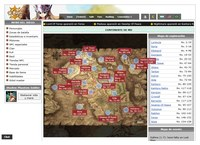
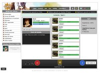
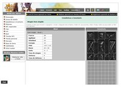
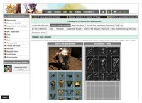

# Mu-Linux Browser Text Game

[](https://mu-linux.com/en/) [](https://mu-linux.com/en/docs/browser-text-game/)

[](https://hub.docker.com/r/emapupi/mu-linux-browser) [](https://hub.docker.com/r/emapupi/mu-linux-browser) [](https://github.com/EmanuelCatania/Mu-Linux-Browser-Text-Game/releases) [](https://github.com/EmanuelCatania/Mu-Linux-Browser-Text-Game/actions/workflows/docker.yml)

[🇦🇷 Español](README.md) | 🇺🇸 English | [🇧🇷 Português](README.pt-BR.md)

A text-based, turn-based MU Online browser game. It is a full rewrite, on PHP 8.4 and MySQL 8.4, of the 2011 browser game: same spirit and same look, with the content brought up to Season 5. It plays in any browser and starts with a single Docker command, on x64 or ARM64.

| | | | |
|---|---|---|---|
| [](Mu-Browser/public/assets/img/shots/1.jpg) | [](Mu-Browser/public/assets/img/shots/2.jpg) | [](Mu-Browser/public/assets/img/shots/3.jpg) | [](Mu-Browser/public/assets/img/shots/4.jpg) |
| Continent map | Battle | Inventory | NPC shops |

## Features

- **Seven classes**: Dark Knight, Dark Wizard, Fairy Elf, Magic Gladiator, Dark Lord, Summoner and Rage Fighter (MG and DL unlock by level), with second and third evolutions, Master Level and a skill tree.
- **More than twenty maps** with spots by level, turn-based combat, skills, the Dark Lord's Dark Horse and Dark Raven, Elf summons and the Shadow Phantom buff.
- **Events**: Golden Invasion, map bosses, Devil Square and Blood Castle, with an announcement bar visible on every screen.
- **Items**: inventory and equipment in the game's style, options, excellent items and sets, third-generation wings and capes, Chaos Machine, vault and twelve NPC vendors (high-level gear only drops).
- **Quests** from Sebina, Marlon and Devin as in Season 5, with their rewards (stat points, Combo, Infinity Arrow…).
- **Social**: party with shared experience on the same map, PvP with bets, guilds, chat, personal stores, market, ranking, forum and notifications.
- **Admin panel**: game settings, news posts with images for the front page, accounts, character and item editor and forum moderation.
- **Three languages** (Spanish, English and Portuguese) and an optional dark mode.

## Try it without installing anything

[](https://codespaces.new/EmanuelCatania/Mu-Linux-Browser-Text-Game?quickstart=1)

Opens the game in [GitHub Codespaces](https://github.com/features/codespaces): sign in with your GitHub account, which includes free hours every month, and the game starts by itself on a temporary server. Once it has started, it opens on port **8086** (*Ports* tab). The code to create the admin account is shown in the terminal with `docker compose -f Mu-Browser/docker-compose.images.yml logs mu-web`, but a normal account is enough to play. When you are done, stop the Codespace so it does not use up your hours.

## Quick start

The full documentation (installation, configuration and development) is at [mu-linux.com](https://mu-linux.com/en/docs/browser-text-game/).

All you need is Docker with the Compose plugin. Using the published image, with nothing to build:

```bash
curl -O https://raw.githubusercontent.com/EmanuelCatania/Mu-Linux-Browser-Text-Game/main/Mu-Browser/docker-compose.images.yml
docker compose -f docker-compose.images.yml up -d
```

Or from source:

```bash
git clone https://github.com/EmanuelCatania/Mu-Linux-Browser-Text-Game.git
cd Mu-Linux-Browser-Text-Game/Mu-Browser
docker compose up -d --build
```

The game runs at http://localhost:8086. The database is created and migrated automatically on startup.

## First run

On the first run there is no administrator. The container prints a code in its log:

```bash
docker compose logs mu-web
```

Open the page, register your account with that code and it becomes the administrator. Later you can grant or remove admin rights from the console:

```bash
docker compose exec mu-web php bin/admin.php <username>
```

(add `--revoke` to remove them).

## Configuration

The `.env` file is optional: everything has a default. To change something, create a `.env` next to the compose file.

| Variable | Default | Purpose |
|---|---|---|
| `WEB_PORT` | `8086` | Game port on the host |
| `MYSQL_ROOT_PASSWORD` | `mu_browser_root` | MySQL root password |
| `MYSQL_USER` / `MYSQL_PASSWORD` | `mu_browser` / `mu_browser` | Game database user |
| `MYSQL_DATABASE` | `mubrowser` | Database name |
| `SESSION_SECRET` | generated | Session key (stored in a volume) |
| `TRUST_PROXY` | `0` | `1` when behind a reverse proxy with HTTPS |
| `TZ` / `TIMEZONE` | `UTC` | Time zone for events |
| `MU_BROWSER_VERSION` | `latest` | Image version (only with `docker-compose.images.yml`) |

If you put it on the internet, change the MySQL passwords before the first start.

## Updating

```bash
docker compose -f docker-compose.images.yml pull
docker compose -f docker-compose.images.yml up -d
```

Data lives in Docker volumes and new migrations are applied automatically.

## x64 and ARM

The image is published for `linux/amd64` and `linux/arm64`: it runs the same on a PC, an x64 VPS, an ARM VPS (Ampere, Graviton) or a Raspberry Pi 4/5 with a 64-bit OS.

## Repository

| Folder | Contents |
|---|---|
| `Mu-Browser/` | The game: code, data, templates, migrations, tests and Docker ([development README](Mu-Browser/README.md), in Spanish) |
| `historico/Classic-2011/` | The original 2011 code, kept as a reference for rules and data. It is not used to run the game |
| `.github/workflows/` | Tests on every push and image publishing on every Release |

## Development

```bash
cd Mu-Browser
docker compose --profile test run --rm --build mu-test
```

## Credits

- **Batanaka** (RaGEZONE), author of the original MU Online browser game: released in April 2011 and updated until 2013. Their code is in `historico/Classic-2011` and is the basis for this version's rules and look.
- Item, monster and quest data taken from MU Online Season 5; minimaps from the game client.
- MU Online is a trademark of Webzen. This is a non-profit fan project and is not affiliated with Webzen.
