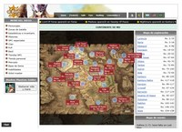
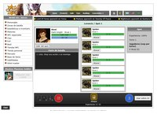
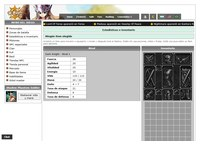
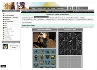

# Mu-Linux Browser Text Game

[](https://hub.docker.com/r/emapupi/mu-linux-browser) [](https://hub.docker.com/r/emapupi/mu-linux-browser) [](https://github.com/EmanuelCatania/Mu-Linux-Browser-Text-Game/releases) [](https://github.com/EmanuelCatania/Mu-Linux-Browser-Text-Game/actions/workflows/docker.yml)

🇦🇷 Español | [🇺🇸 English](README.en.md) | [🇧🇷 Português](README.pt-BR.md)

Juego de navegador de MU Online, por texto y por turnos. Es una reescritura completa, sobre PHP 8.4 y MySQL 8.4, del juego de navegador de 2011: mismo espíritu y misma estética, con el contenido llevado hasta la Season 5. Se juega desde cualquier navegador y se levanta con un solo comando de Docker, en x64 o ARM64.

| | | | |
|---|---|---|---|
| [](Mu-Browser/public/assets/img/shots/1.jpg) | [](Mu-Browser/public/assets/img/shots/2.jpg) | [](Mu-Browser/public/assets/img/shots/3.jpg) | [](Mu-Browser/public/assets/img/shots/4.jpg) |
| Mapa del continente | Batalla | Inventario | Tiendas NPC |

## Qué tiene

- **Siete clases**: Dark Knight, Dark Wizard, Fairy Elf, Magic Gladiator, Dark Lord, Summoner y Rage Fighter (MG y DL se desbloquean por nivel), con segunda y tercera evolución, Master Level y árbol de habilidades.
- **Más de veinte mapas** con spots por nivel, combate por turnos, skills, Dark Horse y Dark Raven del Dark Lord, invocaciones de la Elfa y buff del Shadow Phantom.
- **Eventos**: Golden Invasion, jefes de mapa, Devil Square y Blood Castle, con una barra de anuncios visible desde todas las pantallas.
- **Items**: inventario y equipo con la estética del juego, opciones, excellent y sets, alas de tercera generación y capas, Chaos Machine, baúl y doce vendedores NPC (el equipo alto sólo cae de drop).
- **Quests** de Sebina, Marlon y Devin como en la Season 5, con sus recompensas (puntos de stat, Combo, Infinity Arrow…).
- **Social**: party con experiencia compartida en el mismo mapa, PvP con apuestas, clanes, chat, tiendas personales, mercado, ranking, foro y notificaciones.
- **Panel de administración**: ajustes del juego, noticias con imágenes para la portada, cuentas, editor de personajes e items y moderación del foro.
- **Tres idiomas** (español, inglés y portugués) y modo oscuro opcional.

## Inicio rápido

Sólo hace falta Docker con el plugin Compose. Con la imagen publicada, sin compilar nada:

```bash
curl -O https://raw.githubusercontent.com/EmanuelCatania/Mu-Linux-Browser-Text-Game/main/Mu-Browser/docker-compose.images.yml
docker compose -f docker-compose.images.yml up -d
```

O desde el código:

```bash
git clone https://github.com/EmanuelCatania/Mu-Linux-Browser-Text-Game.git
cd Mu-Linux-Browser-Text-Game/Mu-Browser
docker compose up -d --build
```

El juego queda en http://localhost:8086. La base se crea y se migra sola al arrancar.

## Primer inicio

La primera vez no hay administrador. El contenedor muestra un código en el log:

```bash
docker compose logs mu-web
```

Entrá a la página, registrá tu cuenta con ese código y queda como administradora. Más adelante se pueden dar o quitar permisos desde la consola:

```bash
docker compose exec mu-web php bin/admin.php <usuario>
```

(con `--revoke` para quitarlos).

## Configuración

El `.env` es opcional: todo tiene un valor por defecto. Para cambiar algo, creá un `.env` al lado del compose.

| Variable | Por defecto | Para qué |
|---|---|---|
| `WEB_PORT` | `8086` | Puerto del juego en el host |
| `MYSQL_ROOT_PASSWORD` | `mu_browser_root` | Contraseña de root de MySQL |
| `MYSQL_USER` / `MYSQL_PASSWORD` | `mu_browser` / `mu_browser` | Usuario de la base del juego |
| `MYSQL_DATABASE` | `mubrowser` | Nombre de la base |
| `SESSION_SECRET` | se genera solo | Clave de las sesiones (se guarda en un volumen) |
| `TRUST_PROXY` | `0` | `1` si está detrás de un reverse proxy con HTTPS |
| `TZ` / `TIMEZONE` | `UTC` | Zona horaria de los eventos |
| `MU_BROWSER_VERSION` | `latest` | Versión de la imagen (sólo con `docker-compose.images.yml`) |

Si se publica en internet, cambiá las contraseñas de MySQL antes del primer arranque.

## Actualizar

```bash
docker compose -f docker-compose.images.yml pull
docker compose -f docker-compose.images.yml up -d
```

Los datos viven en volúmenes de Docker y las migraciones nuevas se aplican solas.

## x64 y ARM

La imagen se publica para `linux/amd64` y `linux/arm64`: corre igual en una PC, un VPS x64, un VPS ARM (Ampere, Graviton) o una Raspberry Pi 4/5 con sistema de 64 bits.

## Repositorio

| Carpeta | Qué tiene |
|---|---|
| `Mu-Browser/` | El juego: código, datos, plantillas, migraciones, tests y Docker ([README de desarrollo](Mu-Browser/README.md)) |
| `historico/Classic-2011/` | El código original de 2011, como referencia de reglas y datos. No se usa para correr el juego |
| `.github/workflows/` | Tests en cada push y publicación de la imagen en cada Release |

## Desarrollo

```bash
cd Mu-Browser
docker compose --profile test run --rm --build mu-test
```

## Créditos

- **Batanaka** (RaGEZONE), autor del MU Online de navegador original: lo publicó en abril de 2011 y lo siguió actualizando hasta 2013. Su código está en `historico/Classic-2011` y es la base de las reglas y de la estética de esta versión.
- Datos de items, monstruos y quests tomados de la Season 5 de MU Online; minimapas del cliente del juego.
- MU Online es una marca de Webzen. Este es un proyecto de fans sin fines de lucro y no está afiliado a Webzen.
