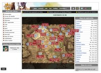
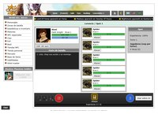
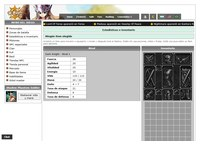
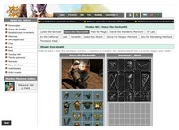

# Mu-Linux Browser Text Game

[](https://mu-linux.com/pt-br/) [](https://mu-linux.com/pt-br/docs/browser-text-game/)

[](https://hub.docker.com/r/emapupi/mu-linux-browser) [](https://hub.docker.com/r/emapupi/mu-linux-browser) [](https://github.com/EmanuelCatania/Mu-Linux-Browser-Text-Game/releases) [](https://github.com/EmanuelCatania/Mu-Linux-Browser-Text-Game/actions/workflows/docker.yml)

[🇦🇷 Español](README.md) | [🇺🇸 English](README.en.md) | 🇧🇷 Português

Jogo de navegador de MU Online, em texto e por turnos. É uma reescrita completa, em PHP 8.4 e MySQL 8.4, do jogo de navegador de 2011: o mesmo espírito e o mesmo visual, com o conteúdo levado até a Season 5. Joga-se em qualquer navegador e sobe com um único comando do Docker, em x64 ou ARM64.

| | | | |
|---|---|---|---|
| [](Mu-Browser/public/assets/img/shots/1.jpg) | [](Mu-Browser/public/assets/img/shots/2.jpg) | [](Mu-Browser/public/assets/img/shots/3.jpg) | [](Mu-Browser/public/assets/img/shots/4.jpg) |
| Mapa do continente | Batalha | Inventário | Lojas NPC |

## O que tem

- **Sete classes**: Dark Knight, Dark Wizard, Fairy Elf, Magic Gladiator, Dark Lord, Summoner e Rage Fighter (MG e DL são liberados por nível), com segunda e terceira evolução, Master Level e árvore de habilidades.
- **Mais de vinte mapas** com spots por nível, combate por turnos, skills, Dark Horse e Dark Raven do Dark Lord, invocações da Elfa e buff do Shadow Phantom.
- **Eventos**: Golden Invasion, chefes de mapa, Devil Square e Blood Castle, com uma barra de avisos visível em todas as telas.
- **Itens**: inventário e equipamento no estilo do jogo, opções, excellent e sets, asas de terceira geração e capas, Chaos Machine, baú e doze vendedores NPC (o equipamento alto só cai como drop).
- **Quests** de Sebina, Marlon e Devin como na Season 5, com suas recompensas (pontos de status, Combo, Infinity Arrow…).
- **Social**: party com experiência compartilhada no mesmo mapa, PvP com apostas, clãs, chat, lojas pessoais, mercado, ranking, fórum e notificações.
- **Painel de administração**: configurações do jogo, notícias com imagens para a página inicial, contas, editor de personagens e itens e moderação do fórum.
- **Três idiomas** (espanhol, inglês e português) e modo escuro opcional.

## Testar sem instalar nada

[](https://codespaces.new/EmanuelCatania/Mu-Linux-Browser-Text-Game?quickstart=1)

Abre o jogo no [GitHub Codespaces](https://github.com/features/codespaces): entra-se com a conta do GitHub, que traz horas grátis por mês, e o jogo sobe sozinho num servidor temporário. Quando terminar de iniciar, ele abre na porta **8086** (aba *Ports*). O código para criar a conta de administrador aparece no terminal com `docker compose -f Mu-Browser/docker-compose.images.yml logs mu-web`, mas para jogar basta registrar uma conta normal. Ao terminar, pare o Codespace para não gastar horas.

## Início rápido

A documentação completa (instalação, configuração e desenvolvimento) está em [mu-linux.com](https://mu-linux.com/pt-br/docs/browser-text-game/).

Só é preciso o Docker com o plugin Compose. Com a imagem publicada, sem compilar nada:

```bash
curl -O https://raw.githubusercontent.com/EmanuelCatania/Mu-Linux-Browser-Text-Game/main/Mu-Browser/docker-compose.images.yml
docker compose -f docker-compose.images.yml up -d
```

Ou a partir do código:

```bash
git clone https://github.com/EmanuelCatania/Mu-Linux-Browser-Text-Game.git
cd Mu-Linux-Browser-Text-Game/Mu-Browser
docker compose up -d --build
```

O jogo fica em http://localhost:8086. O banco é criado e migrado sozinho ao iniciar.

## Primeiro início

Na primeira vez não há administrador. O contêiner mostra um código no log:

```bash
docker compose logs mu-web
```

Abra a página, registre sua conta com esse código e ela vira administradora. Depois dá para conceder ou retirar permissões pelo console:

```bash
docker compose exec mu-web php bin/admin.php <usuario>
```

(com `--revoke` para retirá-las).

## Configuração

O `.env` é opcional: tudo tem um valor padrão. Para mudar algo, crie um `.env` ao lado do compose.

| Variável | Padrão | Para quê |
|---|---|---|
| `WEB_PORT` | `8086` | Porta do jogo no host |
| `MYSQL_ROOT_PASSWORD` | `mu_browser_root` | Senha de root do MySQL |
| `MYSQL_USER` / `MYSQL_PASSWORD` | `mu_browser` / `mu_browser` | Usuário do banco do jogo |
| `MYSQL_DATABASE` | `mubrowser` | Nome do banco |
| `SESSION_SECRET` | gerado sozinho | Chave das sessões (salva em um volume) |
| `TRUST_PROXY` | `0` | `1` se estiver atrás de um reverse proxy com HTTPS |
| `TZ` / `TIMEZONE` | `UTC` | Fuso horário dos eventos |
| `MU_BROWSER_VERSION` | `latest` | Versão da imagem (só com `docker-compose.images.yml`) |

Se for publicar na internet, troque as senhas do MySQL antes do primeiro início.

## Atualizar

```bash
docker compose -f docker-compose.images.yml pull
docker compose -f docker-compose.images.yml up -d
```

Os dados ficam em volumes do Docker e as migrações novas são aplicadas sozinhas.

## x64 e ARM

A imagem é publicada para `linux/amd64` e `linux/arm64`: roda igual num PC, num VPS x64, num VPS ARM (Ampere, Graviton) ou num Raspberry Pi 4/5 com sistema de 64 bits.

## Repositório

| Pasta | O que tem |
|---|---|
| `Mu-Browser/` | O jogo: código, dados, templates, migrações, testes e Docker ([README de desenvolvimento](Mu-Browser/README.md), em espanhol) |
| `historico/Classic-2011/` | O código original de 2011, como referência de regras e dados. Não é usado para rodar o jogo |
| `.github/workflows/` | Testes a cada push e publicação da imagem a cada Release |

## Desenvolvimento

```bash
cd Mu-Browser
docker compose --profile test run --rm --build mu-test
```

## Créditos

- **Batanaka** (RaGEZONE), autor do MU Online de navegador original: publicado em abril de 2011 e atualizado até 2013. O código está em `historico/Classic-2011` e é a base das regras e do visual desta versão.
- Dados de itens, monstros e quests tirados da Season 5 do MU Online; minimapas do cliente do jogo.
- MU Online é uma marca da Webzen. Este é um projeto de fãs sem fins lucrativos e não é afiliado à Webzen.
